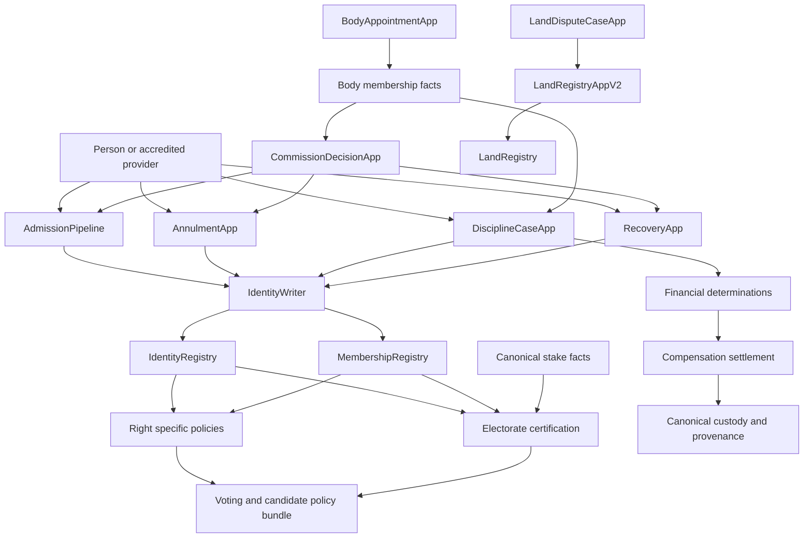

# Phase A architecture and implementation boundaries

Status: IN PROGRESS; engineering recommendations accepted on 3 November 2026. Baseline: `dd0005c15d20754c50a0495cf6d48298b795e1a4`. Prepared 29 October, updated 3 November 2026. Contract implementation is authorised. Most workflows below remain future responsibilities; implemented foundation code is identified separately and no deployment is claimed.

## Design decisions

| ID | Engineering recommendation | Condition |
| --- | --- | --- |
| A01 | Keep stable facts in registries, rules in policies and legal procedure in fixed-purpose applications | Preserve existing enum ordinals and person IDs |
| A02 | One standing typed identity writer and one standing typed land writer | No ordinary office/admin write bypass |
| A03 | Separate citizenship from membership and individual rights orders | L01, L02 and L14 determine legal effects |
| A04 | Share internal threshold, hashing, signature and deadline helpers | No configurable universal judicial engine or arbitrary-call executor |
| A05 | Keep exact receipt consumption in the issuing workflow, atomic with effect execution | Stateful issuer replacement must preserve receipts and open cases |
| A06 | Replace complete immutable policy dependencies together as a reviewed bundle | Every intermediate pointer state must be safe |
| A07 | Prove time-dependent eligibility and snapshot certification before choosing the final implementation | L02 determines whether membership changes roll denominators |
| A08 | Integrate provenance at every canonical stake mutation | Phase D feasibility remains open; a vault-only hook is rejected |
| A09 | Separate land adjudication from one authoritative land writer | L12 and supported registry remedies define scope |
| A10 | Require a release-specific, constrained migration rather than an enduring migrator | L09, L10 and verified live inventory are prerequisites |

A01–A10 are the accepted architecture direction. Exact legal rules/evidence remain as recorded in [Legal decisions](LEGAL-DECISIONS.md); acceptance of a recommendation to define a rule table does not fill its unspecified values. See [the decision record](IMPLEMENTATION-DECISIONS.md).

## Implemented foundation and production assets

[MembershipRegistry](../../contracts/registries/MembershipRegistry.sol) stores independent, already-effective restriction orders for known person IDs. Only the kernel-selected `IDENTITY_WRITER` may record, stay, resume or revoke them. The registry validates order scope, interval, status and per-order revision; the future writer must authenticate and atomically consume the exact legal receipt. No official writer/case workflow is implemented or deployed by this slice. Lifecycle activation, citizenship changes and policy integration are not implemented in this registry.

[The actual interface](../../contracts/interfaces/IMembershipRegistry.sol) exposes fixed-size current restriction facts, not a grant of membership or eligibility. Person/global mutation counters record writes only. Finite expiry changes current reads without incrementing either counter, and there are no electorate callbacks or historical rights certificates. Connecting those counters alone to electorate readiness would be incorrect.

[LiberlandMerit](../../contracts/tokens/LiberlandMerit.sol) is the production ERC20 implementation: name Liberland Merit, symbol LLM, 18 decimals, cap `70_000_000e18`, positive fixed genesis supply at or below that cap. Its constructor mints once to an explicit recipient; there is no later mint authority, owner, proxy, pause or blacklist. Actual supply/recipient and distribution come from the user's genesis package. Unused cap cannot later be minted. The token contains no voting delegation; canonical stake remains the voting-weight source.

The production network is Ethereum mainnet, chain ID 1. The deployment validation requires canonical Ethereum USDC at `0xA0b86991c6218b36c1d19D4a2e9Eb0cE3606eB48`, with 6 decimals. Token supply/controller verification and a complete genesis rehearsal remain release obligations. The new restriction registry is not installed by the current production script.

## Components and boundaries



Arrows represent specific validated calls or fact dependencies, not a permission to execute arbitrary operations. The appointment and adjudication paths obtain powers only after the relevant legal decisions. Financial and land components are later releases with separate gates.

| Component | Owns | Must not own |
| --- | --- | --- |
| Existing `IdentityRegistry` | Stable person records, wallet links and source revisions | New legal procedures or repurposed enum values |
| `MembershipRegistry` | Implemented: independent restriction orders, current summaries and write revisions. Future lifecycle needs a separately specified extension | Citizenship changes, eligibility grants or financial custody |
| `IdentityWriter` | Fixed transition checks and authorised registry writes | Evidence evaluation, parliamentary tallying, broad status setters |
| `BodyMembershipRegistry` instances | People, terms, appointment nonces and roster facts for fixed body kinds | Runtime-configurable body powers |
| `BodyAppointmentApp` | Exact nominations, votes, appointment/removal/veto certificates | Civic status or free-form office administration |
| `CommissionDecisionApp` | Commission case/general decisions, assignment, conflicts and voting | Unrestricted state execution |
| `AdmissionPipeline` | Regular, descent and birth route procedures and final admission receipt | Treating accreditation as citizenship approval |
| `AnnulmentApp` | Annulment procedure, response/review/stays and lawful finding | Ordinary disciplinary revocation |
| `DisciplineCaseApp` | Council/Panel case procedure and separate membership/financial approvals | Citizenship or raw slashing |
| `RecoveryApp` | Exceptional recovery, consent, notice, objection/hearing and exact destination | External assets or private keys |
| `HonoraryRegistry` and minimal authorised workflow | Honorary recognition under its own approval rule | Political citizenship |
| Rights/policy bundle | Explicit eligibility rules over stable facts | Another mutable administration layer |
| Electorate successor if required | Source synchronization, aggregate certification and historical reads | Unbounded per-vote population scans |
| Financial modules | Exposure, case reservations, priority and exact funded settlement | General disciplinary asset confiscation |
| `LandDisputeCaseApp` | Land-law decision procedure | Direct discretionary registry edits |
| `LandRegistryAppV2` | Owner-consented acts and exact approved remedies | Choosing dispute outcomes |

Except for the explicitly implemented foundation above, names denote proposed responsibilities. [Interfaces](INTERFACES.md) and [Authority map](AUTHORITY-MAP.md) define the allowed relationships. Prefer a shared implementation with immutable body kind where facts are identical; do not deploy one contract per case. Add another writer façade only when bytecode size or an independent authority boundary justifies it.

## Existing core and policy dependencies

Preserve the non-repointable router/timelock. New extension IDs use the existing constitutional module-governance route; registration confers no registry write permission. No case is routed through a new generic `GovernanceRouter` action. Existing module classes and authority gates remain the baseline until an explicitly reviewed change.

The future bundle must include:

```text
MembershipRegistry and fixed right readers
    -> CitizenEligibilityPolicy successor with an explicitly defined legacy ABI meaning
    -> VotingPowerPolicy successor (pins citizen/right policy and electorate)
    -> CandidateEligibilityPolicy successor (pins citizen/right policy)
    -> CongressElectionPolicy successor (pins candidate and voting policies)
```

The electorate must use the same approved eligibility rules. Referenda and election cycles pin their starting policies. Repointing only `CITIZEN_ELIGIBILITY_POLICY` is rejected. Current immutable dependencies are in [VotingPowerPolicy](../../contracts/policies/VotingPowerPolicy.sol), [CandidateEligibilityPolicy](../../contracts/policies/CandidateEligibilityPolicy.sol) and [CongressElectionPolicy](../../contracts/policies/CongressElectionPolicy.sol).

Every use of current good standing must be assigned a specific legal purpose in [Rights consumers](RIGHTS-CONSUMERS.csv). Political restriction does not automatically imply loss of property signing, repayment, or credit rights. Preserve the distinction between historical voting weight and current permission to cast.

## Exact effect execution

An approval binds its issuer/domain, subject/matter, kind/stage/revision, rules version, body context, reason commitment and every affected value. It is not a generic signed instruction.

1. The application records an approved effect. Provisional, immediately effective and final effects have separate permitted execution conditions under L05.
2. A caller submits the application's permissionless execution method. A voter may also submit it; the caller has no discretion to change the effect.
3. The application invokes the named writer method. The writer verifies that the caller is the recognised issuer for that effect category.
4. The writer asks that same recognised issuer to consume the exact receipt through its category-specific consume method. The issuer authenticates the writer and checks current effective/final/stay conditions and one-shot use.
5. The writer checks the previous relevant state/version and makes the fixed transition. Any failure rolls back consumption and writes together.

Do not replace category-specific receipt methods with arbitrary `target`, `selector` or `calldata`. Keep consumption canonical in case state. Issuer replacement cannot discard consumed IDs or leave old issuers with indefinite standing powers. Positive authorisation fails closed, including on malformed return data or failed signature checks.

Scope expected-state hashes/nonces to the affected transition. An unrelated metadata edit, wallet migration or concurrent independent order must not permanently strand an otherwise valid approved effect. Any permitted retry or refreshed execution quote preserves the exact authorised legal effect; it cannot change its subject, scope or amount.

## Membership representation

Keep the base membership lifecycle separate from independent orders. Each order identifies the source decision, scope, effect interval and stay/revocation status. A reversal names the affected order. It cannot clear unrelated measures.

Example: political rights end their restriction on November 10; representation remains restricted until December 1. Cancelling an additional political order ending November 20 must reveal the November 10 order. A single `suspendedUntil` cannot implement that.

The implemented storage catalog uses five fixed bit positions from the guide: `Political`, `Community`, `Appointive`, `Representation` and `AppointmentEligibility`. These names are engineering storage labels, not an approved mapping from a legal measure to a consumer or a permission to restrict financial/property rights. L02/L14 supply those exact mappings and protections.

Each right has an indexed max-heap. Current restrictions combine by OR; reads inspect a fixed five roots, and write/relief work is logarithmic in indexed orders per affected right. Indefinite restrictions have an explicit flag and mask, avoiding ambiguity with a zero finite expiry. Stays remove only the named order from its right indexes; resumption restores its original unexpired interval; permanent revocation retains its ID and provenance. Expired entries may remain stored without delaying current rights reads.

This foundation rejects future-start orders and already-expired insertion. It is not a scheduler or historical rights oracle. S01 remains open for legal mapping, lifecycle/future effects and end-to-end growth acceptance. Benchmarks in [Engineering progress](ENGINEERING-PROGRESS.md) show the read/write tradeoff; they do not establish universal gas savings.

## Time and electorate certification

Two concrete denominator choices remain unprovided. The accepted recommendation was to decide this legal question separately from current voting permission:

| Branch | Legal condition | Design consequence |
| --- | --- | --- |
| R0 | Membership restrictions do not alter constitutional roll/headcount | Keep roll semantics; apply rights in current cast/candidacy checks. Prove all direct consumers and historical rules still agree |
| R1 | Restrictions or restoration alter constitutional roll/headcount | Explicit membership source revisions plus bounded timed transitions and certified aggregates are required |

Under R1, a proposed electorate successor detects three sources: identity, stake and membership. Direct rights reads reflect the clock even without a keeper. A global queue can track the next relevant person transition and permit bounded processing. That queue is necessary bookkeeping, not proof of historical correctness.

Candidate certification records block/time, source revisions, policy epoch, aggregate totals and a time-validity horizon. Certification is unavailable while due work or synchronization gaps exist. Same-block source mutations refresh or invalidate that block's certificate. Catch-up in block N cannot certify N-1 retrospectively. Keep new process creation on a valid completed-block certificate; selecting an older block instead of the existing last-completed-block rule needs explicit API/legal review. Do not infer snapshots for unprocessed gaps.

The existing registries' 500,000-gas source-callback budget is a constraint on the successor. Keep callbacks to bounded fixed-size facts; no expiry sweeps or history scans inside them. Preserve detectable deferred synchronization and underfunding protections. Historical old-electorate support needs the active-process choice in L10 and S02.

## Body rules

Commission case panels use fixed assigned participants and compact ballots. Congress fallback counts people across bounded seats. Senate fallback, if authorised, counts seat weight and distinct people separately. One person with many seats cannot satisfy a minimum-person rule.

Use separate mode epoch, roster revision and appointment nonce. Expired terms are detected at read/finalisation time; a transaction-updated epoch cannot detect time expiry alone. L04 defines whether an incomplete stage restarts and which votes/deadlines survive. Do not turn this into a configurable majority engine.

Maintain canonical Commission ordering on authorised roster changes. Define collation/tie-break rules; hashing a name is not alphabetical ordering. Bound or resume assignment against a pinned roster revision, report exhaustion, and use only a legally approved shortfall remedy. Seven commissioners do not guarantee enough eligible disjoint reviewers. L03 and L11 govern exclusions, publication and remedies.

## Gas and storage requirements

- No unbounded history read from a vote, stake operation, rights check or mandatory execution.
- No per-case deployment or full-population snapshot calculation.
- Bound voter/signature, parcel, migration, expiry and claim-allocation work; allow progress across transactions where legally permissible.
- Use fixed-size eligibility views, compact headers and indexed retrieval-only events. Do not copy metadata strings to trigger a rights update.
- Pack fields by actual access pattern. Keep financial values full-width and specify rounding.
- Benchmark cold persisted state, maximum supported rosters, many historical orders and failed callbacks. Enforce chain bytecode limits; use 22 KiB as a proposed warning margin for new modules, not a protocol rule.
- Keep the current compiler/dependency configuration for baseline comparison. A separate upgrade needs its own review.

The October 29 analysis remains the prior baseline. New library/registry implementation, scoped measurements and validation are recorded in [Engineering progress](ENGINEERING-PROGRESS.md). Passing those checks does not establish legal integration or production readiness.

## Specification gates

| ID | Decision or proof needed | Evidence for closure |
| --- | --- | --- |
| S01 | Membership overlap, activation, stay and expiry structure | Executable reference model and boundary/growth scenarios after L02/L05 |
| S02 | R0/R1 denominator choice and certified history | No-keeper, late-keeper, same-block mutation and policy-replacement proof after L02/L10 |
| S03 | Collective voting and rota | Full denominator examples, changing mandates, conflict exhaustion and maximum-size measurements after L03/L04 |
| S04 | Receipt/issuer continuity | Replay, interim/final/stayed effect and rollback scenarios; exact consume protocol |
| S05 | Exposure and loan compatibility | Every mutation reconciles, later deposits protected, loan terms preserved after L07/L08 |
| S06 | Supported land remedy catalog | Each approved remedy maps to a legal registry operation without unlocking unrelated disputes after L12 |
| S07 | Partial governance cutover | Every permitted independent execution order is safe; unsupported states explicitly stop affected operations |

These are remaining design and integration obligations. The user authorised development and accepted recommendations; [Engineering progress](ENGINEERING-PROGRESS.md) records implemented primitives, token, restriction registry and reference models. Their scoped passing tests do not close these gates. [Acceptance scenarios](ACCEPTANCE.md) define the remaining evidence for affected workflows.
